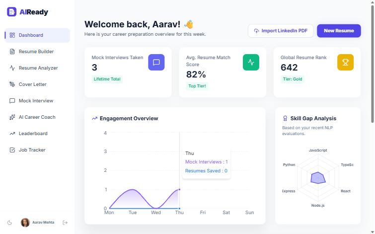
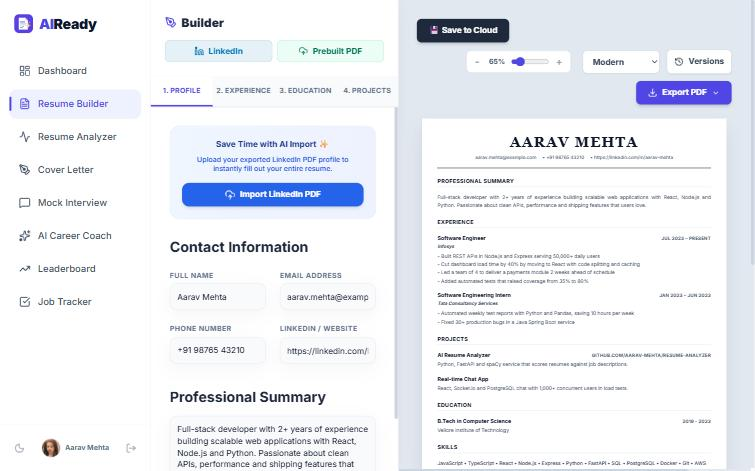
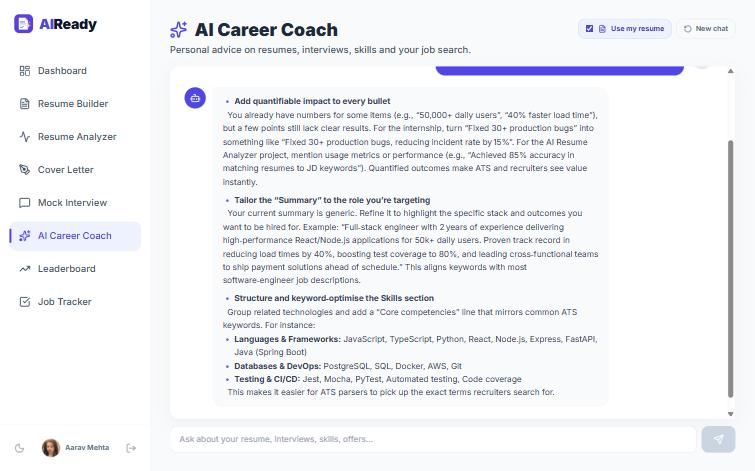
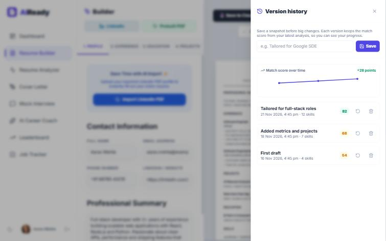
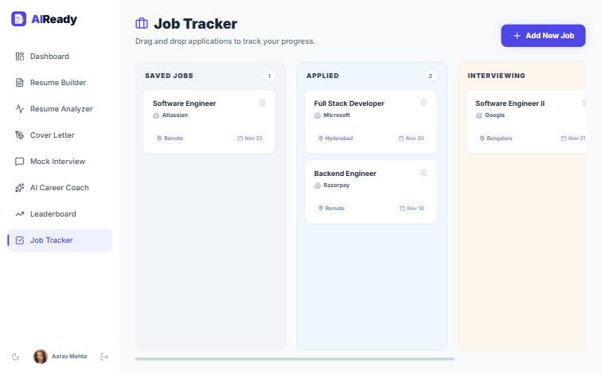
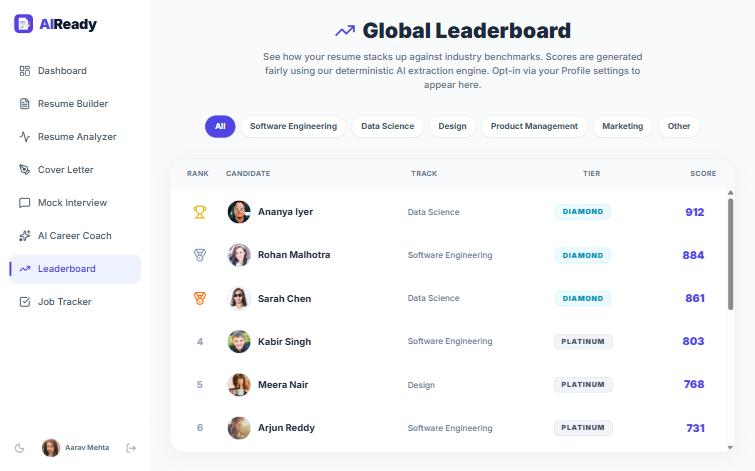
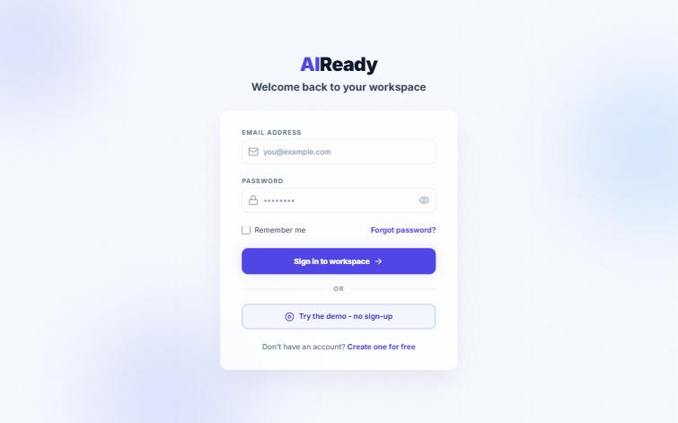

# AIReady — AI Resume & Career Platform

[](https://github.com/Ronakchandna/AIready/actions/workflows/ci.yml)

AIReady helps job seekers **build ATS-friendly resumes, check them against a job description, practise
interviews with AI feedback, write cover letters and track job applications**, all in one web app.

**Live demo:** https://aiready-sigma.vercel.app — click **"Try the demo"** on the login page to explore a
ready-made account (no sign-up).

> The backend and AI engine run on Render's free plan. Once someone opens the site, the backend keeps
> itself and the AI engine awake from 9:30 to 21:30 IST. Otherwise the AI engine has to wake up first
> (usually 1-3 minutes, sometimes longer): the app starts waking it at login, shows a notice while it
> starts, and then finishes the upload/analysis automatically.

---

## Screenshots

| Dashboard | Resume Builder |
|---|---|
|  |  |
| **AI Career Coach** (knows your resume) | **Version history** (score trend) |
|  |  |
| **Job Tracker** (Kanban) | **Leaderboard** |
|  |  |

<p align="center"></p>

---

## Features

| Feature | What it does |
|---|---|
| **Resume Builder** | Form-based editor with a live preview in 10 themes and zoom. Download an **ATS-safe PDF** (selectable text) or a **designed PDF** in the chosen theme. |
| **Version history** | Save snapshots of your resume, see your match score improve over time, restore any version. |
| **AI import** | Upload an existing resume PDF or a LinkedIn profile PDF; the AI fills in the whole builder. **Scanned PDFs are read with OCR.** |
| **AI bullet enhancer** | Rewrites a weak bullet point into a strong, action-verb, impact-focused one. |
| **Skill suggestions** | Paste a job description; NLP extracts the skills it wants that your resume is missing. |
| **Resume Analyzer** | Upload a PDF + job description → match score, ATS score with breakdown, matched/missing skills, section check and AI suggestions. |
| **Mock Interview** | 5 questions tailored to the job (and your resume), voice input/output, 90-second stress timer, AI scoring of each answer, PDF report. |
| **AI Career Coach** | Chat with an AI coach that knows your resume: what to learn, interview prep, referrals, offers. |
| **Cover Letter** | Personalised cover letter from your resume + job description; copy or download as PDF. |
| **Job Tracker** | Kanban board (saved → applied → interviewing → offer / rejected) with drag and drop. |
| **Dashboard** | Interview count, average score, ATS hits, 7-day activity chart and recent activity. |
| **Global Rank & Leaderboard** | 0–1000 score and tier (Bronze → Diamond) from your resume; opt-in public leaderboard and profile page. |
| **Accounts** | Register/login (JWT), one-click demo account, profile, stored resume PDFs, dark mode. |

## Architecture

```
Browser ──► frontend (React, Vercel) ──► backend (Node/Express, Render) ──► Supabase PostgreSQL
                                              │   users, resumes, jobs, interviews, uploaded PDFs
                                              └──(x-api-key)──► ai-engine (FastAPI, Render) ──► Groq LLM
                                                                spaCy + scikit-learn NLP
```

| Folder | Stack | Purpose |
|---|---|---|
| [`frontend/`](frontend) | React 19, React Router 7, Tailwind CSS, Framer Motion, Recharts, jsPDF | The web app |
| [`backend/`](backend) | Node.js 22, Express 5, PostgreSQL (`pg`), JWT, bcrypt, Multer, Helmet | Auth, data, file storage, gateway to the AI engine |
| [`ai-engine/`](ai-engine) | Python 3.12, FastAPI, spaCy, scikit-learn, PyMuPDF + Tesseract OCR, Groq (`openai/gpt-oss-120b`) | NLP, ATS scoring, PDF parsing, LLM features |

Every AI feature has an **offline fallback**: if the LLM is unavailable, the engine answers with
rule-based NLP results and marks them `"fallback": true`.

## Run locally

Requirements: Node.js 20+, Python 3.12, a PostgreSQL database (e.g. a free Supabase project) and a free Groq API key.

```bash
# 1. AI engine  (http://localhost:8000, test UI at /ui)
cd ai-engine
python -m venv .venv && .venv\Scripts\activate      # macOS/Linux: source .venv/bin/activate
pip install -r requirements.txt
copy .env.example .env                               # set GROQ_API_KEY and API_KEY
uvicorn main:app --reload

# 2. Backend  (http://localhost:5000/api)
cd backend
npm install
copy .env.example .env                               # set DATABASE_URL, JWT_SECRET, AI_API_KEY (= engine API_KEY)
npm start                                            # creates the tables + demo leaderboard automatically

# 3. Frontend  (http://localhost:3000)
cd frontend
npm install
copy .env.example .env
npm start
```

## Tests

```bash
cd backend   && npm test                      # 15 API tests on an in-memory PostgreSQL (PGlite)
cd ai-engine && pytest                        # 31 tests: NLP, scoring, API, security, chat, OCR, offline fallbacks
cd frontend  && npm test -- --watchAll=false  # 7 tests: login + demo flow, PDF generator
cd frontend  && npm run build                 # production build (lint errors fail the build)
```

GitHub Actions runs all of these on every push ([`.github/workflows/ci.yml`](.github/workflows/ci.yml)).
[`keep-awake.yml`](.github/workflows/keep-awake.yml) pings the free Render services every 10 minutes during the day.

## Deployment

| Part | Host | URL |
|---|---|---|
| Frontend | Vercel (project root `frontend`, env `REACT_APP_NODE_API_URL`) | https://aiready-sigma.vercel.app |
| Frontend (mirror) | Render static site | https://airesume-web.onrender.com |
| Backend | Render web service | https://airesume-backend-xmgp.onrender.com/api |
| AI engine | Render (Docker) | https://ai-resume-engine.onrender.com |
| Database | Supabase PostgreSQL (session pooler) | — |

[`render.yaml`](render.yaml) is a Render Blueprint for all three services. Secrets are entered in the
Render dashboard: `DATABASE_URL`, `GROQ_API_KEY`, and optionally `BREVO_API_KEY` + `EMAIL_FROM` for
password-reset emails. Every push to `main` redeploys only the part that changed.

See **[full detail.md](full%20detail.md)** for the complete project report: design, algorithms,
database schema, API reference, security, testing and results.
